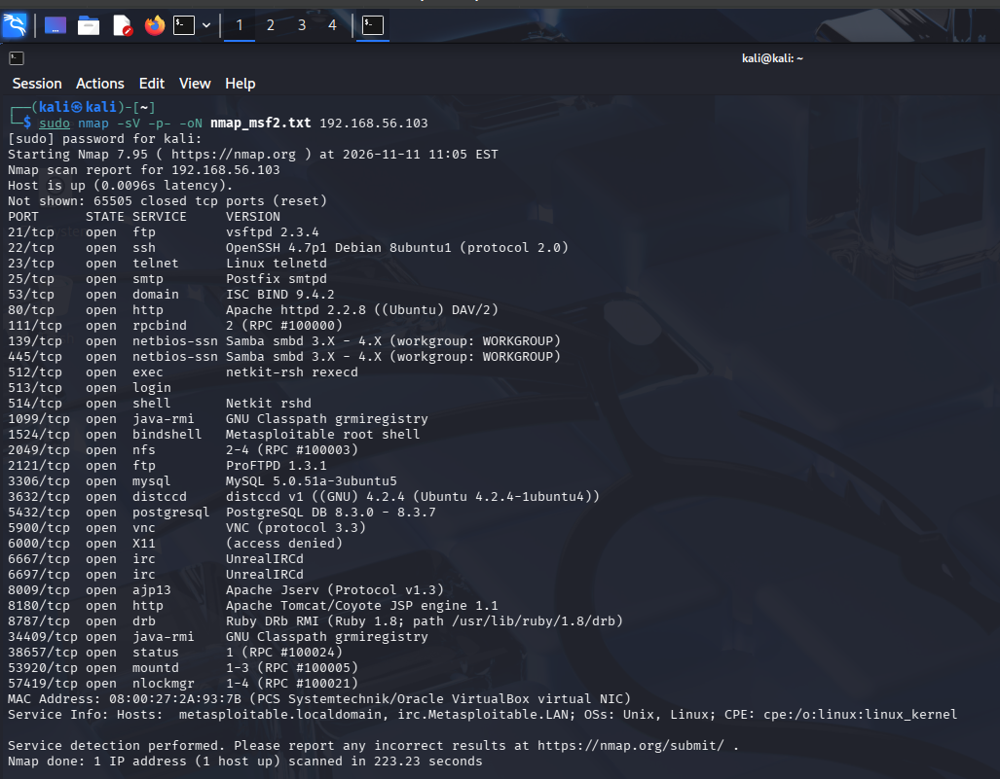

[← Back to portfolio](../../)

## Objective

Map the attack surface of a deliberately vulnerable machine: identify its open ports and running services with their versions, assess the main risk of each, and recommend fixes.

## Environment and tools

| Component | Details                                                                     |
| --------- | --------------------------------------------------------------------------- |
| Lab       | My isolated [virtual lab](../virtual-lab-setup/) (host-only `192.168.56.0/24`) |
| Scanner   | Nmap 7.95 on Kali Linux 2025.4 (`192.168.56.104`)                           |
| Target    | Metasploitable 2 (`192.168.56.103`)                                         |
| Sources   | National Vulnerability Database (NVD) for CVE details                      |

The scan stayed inside my own lab: the MAC address in the results (`08:00:27:…`, Oracle VirtualBox virtual NIC) confirms that the target was my virtual machine.

## Method

1. Ran a full service and version scan from Kali on 11 November 2026:

   ```bash
   sudo nmap -sV -p- -oN nmap_msf2.txt 192.168.56.103
   ```

   | Option | Purpose                               |
   | ------ | ------------------------------------- |
   | `-sV`  | Detect service versions               |
   | `-p-`  | Scan all 65,535 TCP ports             |
   | `-oN`  | Save the output to a text file        |

2. Listed each open port with its service and version, and noted its main security risk.
3. Checked the most serious findings against the NVD.

## Results

Nmap found **30 open TCP ports** and 65,505 closed ports in 223 seconds.



| Port(s)                       | Service / version            | Main security risk                                                      |
| ----------------------------- | ---------------------------- | ----------------------------------------------------------------------- |
| 21                            | FTP, vsftpd 2.3.4            | Passwords sent in clear text; this version has a known backdoor         |
| 22                            | SSH, OpenSSH 4.7p1           | Old version, but the connection is encrypted                            |
| 23                            | Telnet                       | Passwords sent in clear text                                            |
| 25                            | SMTP, Postfix                | Can be used to send spam if badly configured                            |
| 53                            | DNS, BIND 9.4.2              | Can reveal information about the network                                |
| 80                            | HTTP, Apache 2.2.8 / DAV/2   | WebDAV can allow files to be uploaded or modified                       |
| 111, 2049, 38657, 53920, 57419 | RPC / NFS                   | Can expose shared files and network information                         |
| 139, 445                      | Samba 3.X – 4.X              | Private files can be accessed or modified                               |
| 512, 513, 514                 | rexecd, rlogin, rshd         | Old remote access services; data can be sent without encryption         |
| 1099, 34409                   | Java RMI                     | Can allow remote commands if not protected                              |
| 1524                          | Bind shell                   | Direct root access to the machine, without a password                   |
| 2121                          | FTP, ProFTPD 1.3.1           | Data can be read if the connection is not encrypted                     |
| 3306                          | MySQL 5.0.51a                | Database information can be stolen                                      |
| 3632                          | distccd v1                   | Can allow remote commands                                               |
| 5432                          | PostgreSQL 8.3               | Database information can be read or modified                            |
| 5900                          | VNC, protocol 3.3            | Connection not encrypted by default                                     |
| 6000                          | X11                          | Access was refused, but a weakly protected X11 port can expose the graphical session |
| 6667, 6697                    | IRC, UnrealIRCd              | Some versions have a known backdoor                                     |
| 8009                          | AJP13, Apache JServ          | Can expose information if badly configured                              |
| 8180                          | HTTP, Apache Tomcat          | Administration access can be exposed                                    |
| 8787                          | Ruby DRb, Ruby 1.8           | Can allow remote commands                                               |

### Known vulnerabilities

| Service    | CVE           | Description                                                     | Confirmed by the scan?                       |
| ---------- | ------------- | --------------------------------------------------------------- | -------------------------------------------- |
| vsftpd 2.3.4 | [CVE-2011-2523](https://nvd.nist.gov/vuln/detail/CVE-2011-2523) | Modified version containing a backdoor that allows remote command execution | Yes – the exact vulnerable version was detected |
| UnrealIRCd | [CVE-2010-2075](https://nvd.nist.gov/vuln/detail/CVE-2010-2075) | Modified version allowing remote command execution              | No – Nmap did not show the exact version     |
| distccd    | [CVE-2004-2687](https://nvd.nist.gov/vuln/detail/CVE-2004-2687) | Can allow remote command execution                              | No – the scan alone is not proof             |

For Samba, Nmap only reported a version range (3.x to 4.x), so no specific vulnerability can be confirmed without the exact version.

## Conclusion and remediation

The machine exposes a very large attack surface, with many services running software from 2007–2008. To secure it, I would:

1. **Close every unnecessary port**, starting with the bind shell on port 1524 and the `r*` services (512–514).
2. **Replace clear-text protocols** such as Telnet and FTP with encrypted alternatives (SSH, SFTP).
3. **Update all software** to supported versions to fix known vulnerabilities such as the vsftpd 2.3.4 backdoor.

## What I would do differently

- A version number alone does not prove a vulnerability. Next time, I would go one step further for uncertain services (UnrealIRCd, Samba) and use Nmap scripts (NSE) to obtain the exact version before drawing conclusions.
- Keep the scan output file (`nmap_msf2.txt`) in the evidence folder alongside the screenshot, so the full results can be reviewed as text.
