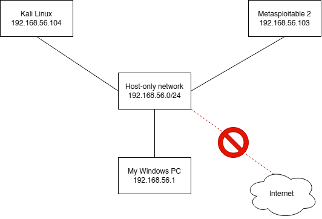
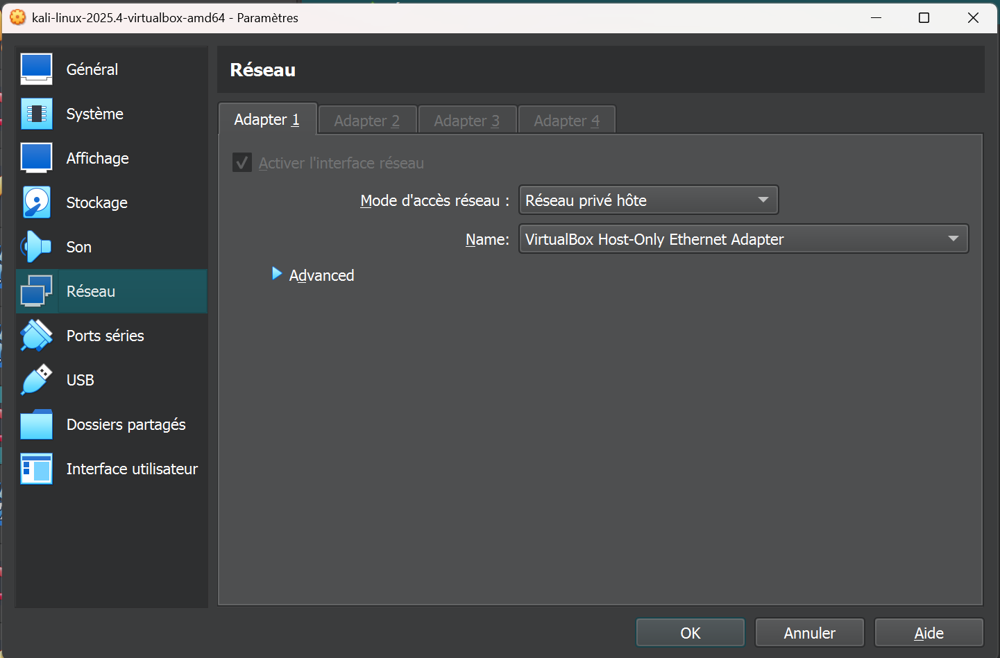
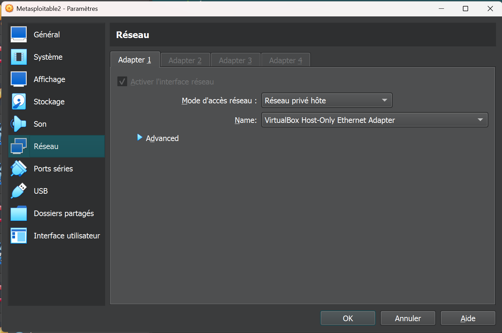
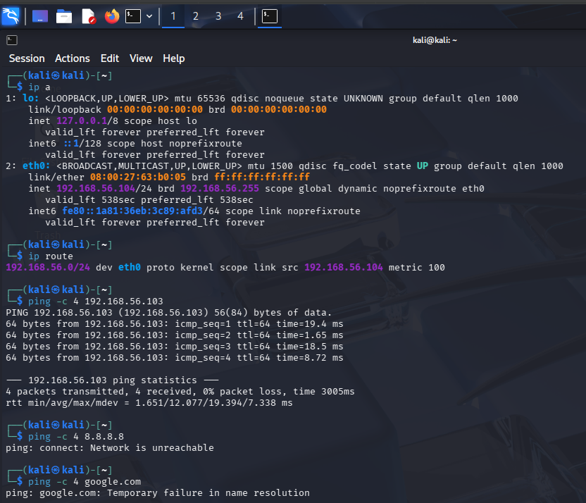
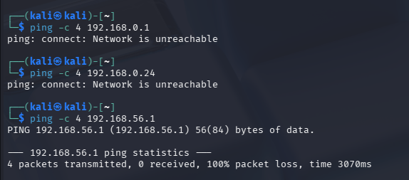
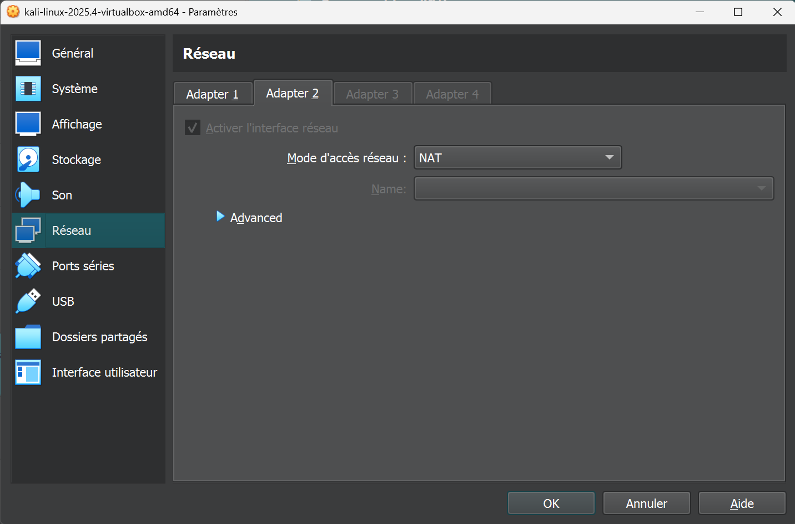

[← Back to portfolio](../../)

## Objective

Build an isolated virtual lab to practise security testing legally and safely, with no risk of exposing a deliberately vulnerable machine to my home network or the Internet.

## Environment and tools

| Component  | Details                                                            |
| ---------- | ------------------------------------------------------------------ |
| Hypervisor | VirtualBox 7.0.8                                                   |
| Attacker   | Kali Linux 2025.4                                                  |
| Target     | Metasploitable 2 (deliberately vulnerable)                         |
| Network    | VirtualBox host-only network `192.168.56.0/24`, no NAT, no bridge  |

## Method

1. Created two virtual machines in VirtualBox: Kali Linux (attacker) and Metasploitable 2 (target).
2. Attached Adapter 1 of each VM to the host-only network and disabled every other adapter, including the NAT adapter enabled by default in the Kali image.
3. Started both VMs and checked their addresses: Metasploitable 2 on `192.168.56.103`, Kali on `192.168.56.104/24` with no default route.
4. From Kali, tested that the target was reachable and that the Internet and my home network were not.

| Kali network settings | Metasploitable 2 network settings |
| --- | --- |
|  |  |

## Results

| Test from Kali                          | Expected            | Result                                                            |
| --------------------------------------- | ------------------- | ----------------------------------------------------------------- |
| Ping Metasploitable 2                   | Reachable           | ✅ 0% packet loss                                                 |
| Ping `8.8.8.8`                          | Unreachable         | ✅ "Network is unreachable"                                       |
| Resolve `google.com`                    | Fails               | ✅ "Temporary failure in name resolution"                         |
| Ping home router and host Wi-Fi address | Unreachable         | ✅ "Network is unreachable"                                       |
| Ping host's host-only address           | Reachable by design | Packets arrive, but Windows Firewall blocks the reply (100% loss) |

The lab can reach its target but has no route to the Internet or to my home network: it is isolated.

## Troubleshooting

| Problem                                                | Cause                                                                     | Fix                                                  |
| ------------------------------------------------------ | ------------------------------------------------------------------------- | ---------------------------------------------------- |
| Kali had Internet access                               | A second adapter in NAT mode is enabled by default in the official image | Disabled it and kept only the host-only adapter      |
| Network settings greyed out                            | The VM was in a saved state, not powered off                              | Discarded the saved state, then changed the settings |
| Kali would not boot (black screen, blinking Caps Lock) | Kernel panic                                                              | Reset the VM; it then started normally               |

## What I would do differently

- Check every adapter right after importing a VM image, instead of trusting the defaults.
- Take a snapshot of each clean VM before testing, so I can restore it quickly after a crash or a risky test.
- Keep Windows Firewall enabled during tests: it protects the host, which is the only other machine on the lab network.
